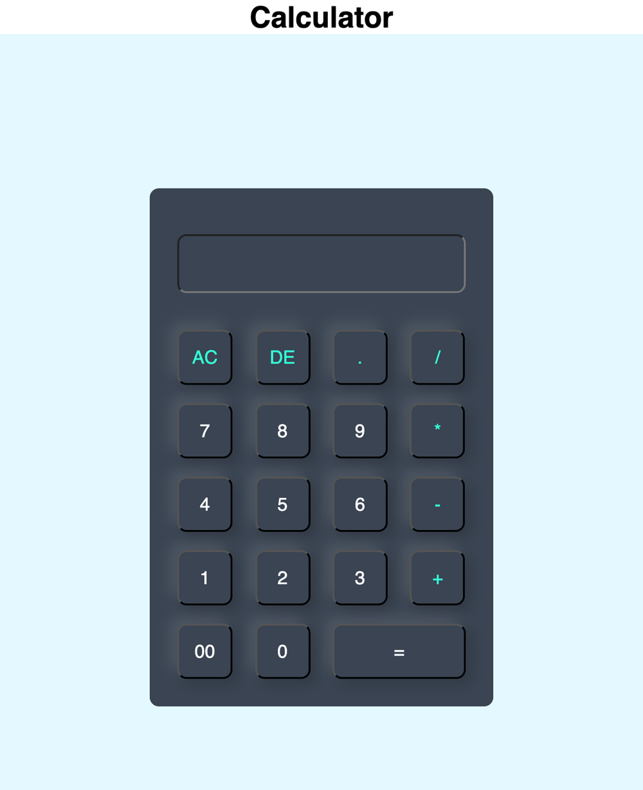

# Calculator

A basic calculator in plain HTML and CSS with inline JavaScript handlers. One of the first things I built while learning web development, kept here as-is.

**Try it:** https://kaankuzu1.github.io/ProjectCalculator/



## How it works

There is no framework and no separate script file. Each button appends to the display input through an inline `onclick`, and `=` evaluates the expression. `style.css` handles the neumorphic look.

## Running locally

```bash
git clone https://github.com/kaankuzu1/ProjectCalculator.git
open ProjectCalculator/index.html
```
